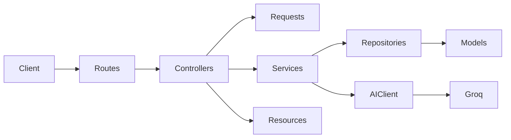

# Blog API

---

## Project Overview

This project is a versioned Laravel 12 JSON API (`/api/v1`). Clients register, verify email, and authenticate with Sanctum access and refresh tokens. Authenticated users can publish posts (with optional images), like and comment on posts, and generate draft posts from a topic using Groq.

Interactive OpenAPI docs are generated by Dedoc Scramble at `/docs/api`.

---

## Features

- User registration with optional profile picture
- Email verification (signed link + resend)
- Login with access token and refresh token
- Profile, token refresh, and logout
- Forgot / reset password
- CRUD posts owned by the authenticated user
- Upload, list, and delete post images
- Publish a post from an AI draft
- Like and unlike a post
- Comments and nested replies
- AI post-draft generation (topic, language, optional image and tone)
- Rate limiting on API, uploads, and auth email flows
- Scramble UI with Bearer token authorization

---


## Tech Stack


| Layer     | Technology                                           |
| --------- | ---------------------------------------------------- |
| Runtime   | PHP 8.2+                                             |
| Framework | Laravel 12                                           |
| Auth      | Laravel Sanctum (personal access tokens + abilities) |
| Database  | Sql                                                  |
| Mail      | Laravel mail (SMTP)                                  |
| AI        | Groq Chat Completions (`app/Clients/AIClient.php`)   |
| API docs  | Dedoc Scramble                                       |
| Storage   | Public disk (`storage/app/public`)                   |
| Tests     | PHPUnit 11                                           |


---


## Architecture

The API follows a layered flow: **Route → Controller → Form Request → Service → Repository → Eloquent Model**. Controllers stay thin. JSON shape is defined in API Resources. External AI calls go through a dedicated client.




| Layer          | Location                                  | Role                                          |
| -------------- | ----------------------------------------- | --------------------------------------------- |
| Routes         | `routes/api.php`                          | Versioned `/api/v1` endpoints and middleware  |
| Controllers    | `app/Http/Controllers/Api/V1`             | HTTP actions, status codes, response wrapping |
| Form Requests  | `app/Http/Requests`                       | Validation and authorization of input         |
| Resources      | `app/Http/Resources`                      | JSON serialization                            |
| Services       | `app/Services`                            | Application use cases                         |
| Repositories   | `app/Repositories/Contracts` + `Eloquent` | Data access; bound in `AppServiceProvider`    |
| Models         | `app/Models`                              | Eloquent entities and relations               |
| Clients        | `app/Clients`                             | HTTP to Groq                                  |
| Traits / Enums | `app/Traits`, `app/Enums`                 | Image storage helpers; token abilities        |


Bindings registered in `AppServiceProvider`:

- `UserRepoInterface` → `UserRepo`
- `PostRepoInterface` → `PostRepo`
- `PostDraftRepoInterface` → `PostDraftRepo`
- `ImageRepoInterface` → `ImageRepo`
- `LikeRepoInterface` → `LikeRepo`
- `CommentRepoInterface` → `CommentRepo`

Domain relations:

- `User` has many posts, drafts, likes, and comments
- `Post` belongs to an author; has many images, likes, and comments
- `Comment` may have a `parent_id` for replies
- `Image` belongs to a post (UUID primary key)

---


## Requirements

- PHP 8.2 or newer with extensions Laravel needs (`openssl`, `pdo`, `mbstring`, `tokenizer`, `xml`, `ctype`, `json`, `fileinfo`)
- Composer
- A database (MySQL/MariaDB via XAMPP, or SQLite)
- Node.js and npm only if you run Vite / `composer run dev`
- Groq API key for draft generation
- Mail configuration for verification and password reset (Resend key if you use Resend)

---


## Installation

From the project root:

```bash
composer install
cp .env.example .env
php artisan key:generate
```

Configure `.env` (see [Environment Variables](#environment-variables) and [Database](#database)).

```bash
php artisan migrate
php artisan storage:link
```

Serve the app:

```bash
php artisan serve
```

API base URL: `http://127.0.0.1:8000/api/v1`

If you use XAMPP Apache instead of `artisan serve`, point the document root at `public/` (or use `http://localhost/laravel-_api_app/public`). Keep `APP_URL` in sync with that URL.

Interactive docs (local): [http://127.0.0.1:8000/docs/api](http://127.0.0.1:8000/docs/api)

Paste a Sanctum access token in the Scramble **Authorize** field to call protected endpoints.

Optional all-in-one local stack (server, queue, logs, Vite):

```bash
composer run dev
```

---


## Environment Variables

Copy `.env.example` and set at least the following.


| Variable                                                              | Purpose                                                     |
| --------------------------------------------------------------------- | ----------------------------------------------------------- |
| `APP_NAME`                                                            | App name (also used as mail from-name)                      |
| `APP_ENV`                                                             | `local`, `testing`, or `production`                         |
| `APP_KEY`                                                             | Encryption key (`php artisan key:generate`)                 |
| `APP_DEBUG`                                                           | Detailed errors; keep `false` in production                 |
| `APP_URL`                                                             | Public base URL (used in verification links and asset URLs) |
| `DB_CONNECTION`                                                       | `mysql` or `sqlite`                                         |
| `DB_HOST` / `DB_PORT` / `DB_DATABASE` / `DB_USERNAME` / `DB_PASSWORD` | MySQL connection                                            |
| `FILESYSTEM_DISK`                                                     | Default disk; uploaded images use the `public` disk in code |
| `MAIL_MAILER`                                                         | `log`, `smtp`, `resend`, etc.                               |
| `MAIL_FROM_ADDRESS` / `MAIL_FROM_NAME`                                | Outgoing mail identity                                      |
| `ACCESS_T`                                                            | Access token lifetime in minutes (default `120`)            |
| `REFRESH_T`                                                           | Used for refresh token lifetime (`config/sanctum.php`)      |
| `GROQ_API_KEY`                                                        | Groq API key                                                |
| `GROQ_BASE_URL`                                                       | Groq API base URL                                           |
| `GROQ_MODEL`                                                          | Chat model name                                             |


Token lifetimes are read from `config/sanctum.php` (`access_token_expiration`, `refresh_token_expiration`).

---


## Database

Default `.env.example` uses SQLite. For XAMPP MySQL, use something like:

```env
DB_CONNECTION=mysql
DB_HOST=127.0.0.1
DB_PORT=3306
DB_DATABASE=laravel-_api_app
DB_USERNAME=root
DB_PASSWORD=
```

Create the database, then:

```bash
php artisan migrate
```

Main tables:


| Table                         | Notes                                                            |
| ----------------------------- | ---------------------------------------------------------------- |
| `users`                       | Accounts, profile picture path, soft deletes, email verification |
| `personal_access_tokens`      | Sanctum tokens                                                   |
| `posts`                       | Title, body, `author_id`, soft deletes                           |
| `images`                      | UUID id, `post_id`, `image_path`                                 |
| `post_drafts`                 | AI drafts (title, body, description, optional image, tags)       |
| `likes`                       | UUID id, unique (`post_id`, `user_id`), soft deletes             |
| `comments`                    | UUID id, `content`, optional `parent_id`, soft deletes           |
| `jobs` / `cache` / `sessions` | Laravel internals depending on `.env` drivers                    |


Rollback a single migration file (project Composer script):

```bash
file=2026_11_04_200000_drop_images_column_from_posts_table.php composer rollback:migration
```

---


## Authentication

Sanctum personal access tokens with abilities:


| Token         | Ability              | Used for                                                             |
| ------------- | -------------------- | -------------------------------------------------------------------- |
| Access token  | `access_api`         | Posts, drafts, likes, comments, profile, logout, resend verification |
| Refresh token | `issue_access_token` | `POST /api/v1/auth/refresh` only                                     |


Send the access token on protected routes:

```http
Authorization: Bearer {access_token}
```

Public (no Bearer token):

- `POST /api/v1/auth/register`
- `POST /api/v1/auth/login`
- `POST /api/v1/auth/forgot-password`
- `POST /api/v1/auth/reset-password`
- `GET /api/v1/email/verify/{id}/{hash}` (signed URL)

`User` implements `MustVerifyEmail`. Registration fires `Registered` and sends a verification notification. Resend requires a valid access token.

Password reset: request a link with email, then submit `token`, `email`, and confirmed `password`.

Logout deletes the **current** access token.

---


## API Endpoints

Base path: `/api/v1`

Interactive schemas, examples, and “try it” live at `/docs/api`.

### Auth


| Method | Path                    | Auth    | Description                                                                                |
| ------ | ----------------------- | ------- | ------------------------------------------------------------------------------------------ |
| `POST` | `/auth/register`        | No      | Create user (`name`, `email`, `password`, `password_confirmation`, optional `profile_pic`) |
| `POST` | `/auth/login`           | No      | Returns `access_token`, `refresh_token`, and user                                          |
| `GET`  | `/auth/profile`         | Access  | Current user (with posts)                                                                  |
| `POST` | `/auth/refresh`         | Refresh | New access token                                                                           |
| `GET`  | `/auth/logout`          | Access  | Revoke current access token                                                                |
| `POST` | `/auth/forgot-password` | No      | Send reset link (`email`)                                                                  |
| `POST` | `/auth/reset-password`  | No      | Reset password (`token`, `email`, `password`, `password_confirmation`)                     |


### Email verification


| Method | Path                        | Auth   | Description               |
| ------ | --------------------------- | ------ | ------------------------- |
| `GET`  | `/email/verify/{id}/{hash}` | Signed | Mark email verified       |
| `GET`  | `/email/resend`             | Access | Resend verification email |


### Posts


| Method        | Path                       | Auth   | Description                                               |
| ------------- | -------------------------- | ------ | --------------------------------------------------------- |
| `GET`         | `/posts`                   | Access | Paginated posts with author and images                    |
| `POST`        | `/posts`                   | Access | Create post (`title`, `body`, optional `images[]`, max 4) |
| `GET`         | `/posts/{id}`              | Access | Show a post owned by the current user                     |
| `PUT`/`PATCH` | `/posts/{post}`            | Access | Update title, body, and/or images                         |
| `DELETE`      | `/posts/{post}`            | Access | Soft-delete a post you own                                |
| `POST`        | `/posts/destroy_image`     | Access | Delete images (`post_id`, `ids[]` UUIDs)                  |
| `POST`        | `/posts/create_from_draft` | Access | Create a post from `draft_id`                             |


### Likes


| Method | Path                   | Auth   | Description                          |
| ------ | ---------------------- | ------ | ------------------------------------ |
| `POST` | `/posts/{post}/like`   | Access | Like a post (`409` if already liked) |
| `POST` | `/posts/{post}/unlike` | Access | Remove like (`204`)                  |


### Comments


| Method   | Path                               | Auth   | Description                  |
| -------- | ---------------------------------- | ------ | ---------------------------- |
| `GET`    | `/posts/{post}/comments`           | Access | List comments (with replies) |
| `POST`   | `/posts/{post}/comments`           | Access | Create comment (`content`)   |
| `POST`   | `/posts/{post}/comments/{comment}` | Access | Reply to a comment           |
| `PATCH`  | `/posts/{post}/comments/{comment}` | Access | Update your comment          |
| `DELETE` | `/comments/{comment}`              | Access | Delete a comment (`204`)     |


### Post drafts (AI)


| Method | Path         | Auth   | Description                                                                  |
| ------ | ------------ | ------ | ---------------------------------------------------------------------------- |
| `GET`  | `/postDraft` | Access | List the current user’s drafts                                               |
| `POST` | `/postDraft` | Access | Generate a draft (`topic`, `lang`, optional `image`, `instructions`, `tone`) |


### Health


| Method | Path         | Auth | Description              |
| ------ | ------------ | ---- | ------------------------ |
| `GET`  | `/api/hello` | No   | `{ "message": "hello" }` |
| `GET`  | `/up`        | No   | Laravel health check     |


Typical JSON envelope:

```json
{
  "status": "Success",
  "message": "post is retrieved",
  "post": {}
}
```

---


## Error Handling

Controllers return JSON with `"status": "Error"` and a `message` for business failures. Laravel Form Requests return **422** validation errors. Sanctum returns **401** when the token is missing, invalid, or lacks the required ability.


| Status | When                                                                                       |
| ------ | ------------------------------------------------------------------------------------------ |
| `200`  | Successful read / update / password email sent                                             |
| `201`  | Created (user, post, like, comment, draft)                                                 |
| `204`  | Deleted (post, like, comment, images, logout)                                              |
| `400`  | Domain error (post not found, not owner, unlike without like, draft create failed)         |
| `401`  | Invalid credentials or unauthenticated                                                     |
| `403`  | Invalid verification link, or image does not belong to the post                            |
| `409`  | Post already liked                                                                         |
| `422`  | Validation failed or invalid/expired password reset token                                  |
| `429`  | Rate limit (API 20/min, global 120/min, uploads 10/min, auth email throttles) or Groq busy |


Rate limiters are defined in `AppServiceProvider::boot()`.

---


## License

This project is open-sourced.